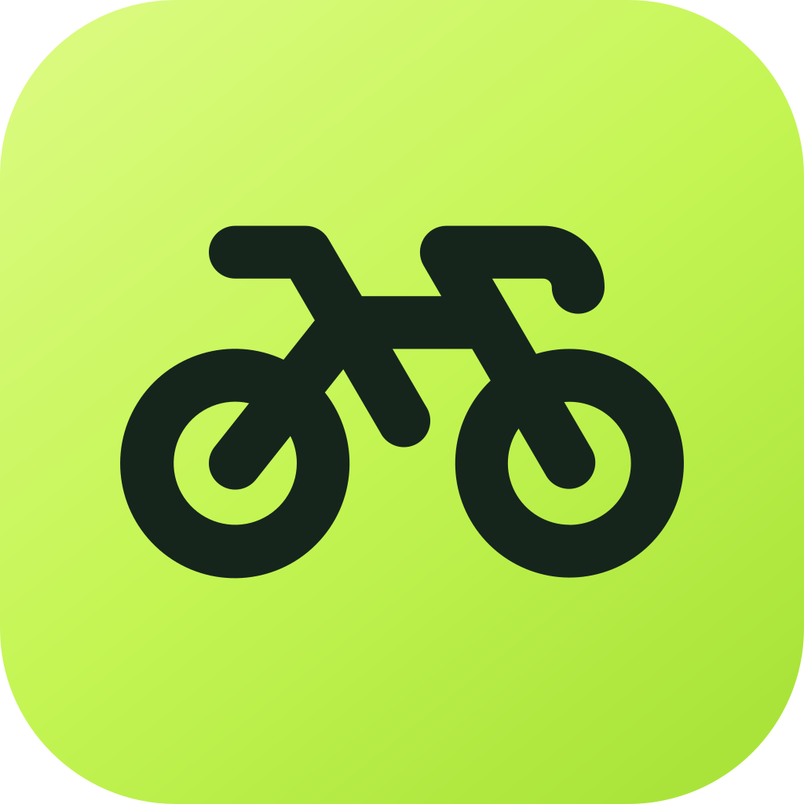
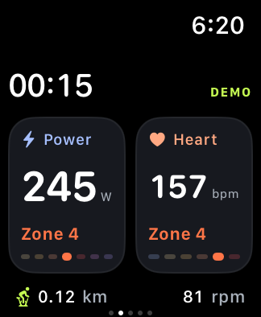
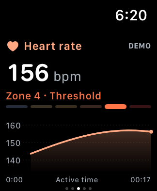
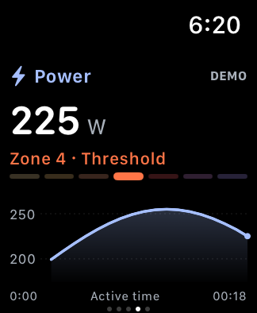
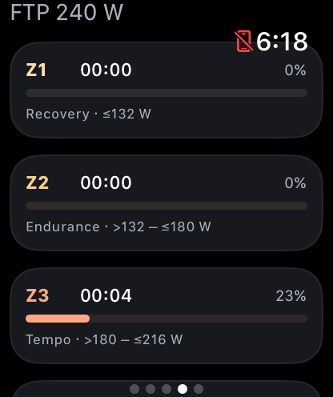

# BikeTrack



A lightweight, standalone Apple Watch app for tracking indoor bike sessions, based on the feature brief in the [CaPowHr developer's post](https://www.reddit.com/r/IndoorCycling/comments/1qd9zjm/i_built_a_free_apple_watch_app_to_sync_indoor/). This is an independent Swift implementation with its own name and interface.

## What it does

- Connects directly from the Watch to a bike or treadmill over Bluetooth.
- Reads FTMS indoor-bike/treadmill data, Cycling Power, and Cycling Speed & Cadence measurements.
- Combines equipment metrics with the Watch's heart rate and active energy.
- Records indoor cycling, running, and walking workouts to HealthKit for Apple Fitness and Health.
- Shows power, cadence, speed, distance, elapsed time, heart rate, and energy when available.
- Shows live heart-rate and cycling power zones, with separate trend charts and time-in-zone breakdowns.
- Saves chart data and each workout's maximum-heart-rate/FTP settings alongside local history.
- Supports pause/resume, automatic reconnection, save retries, and active-workout recovery.
- Retains the last 100 saved workout summaries locally.
- Offers metric/imperial units and optional calibrated wheel-distance estimation.
- Captures local diagnostics that the user can share explicitly.
- Includes a labeled demo mode that never writes to Health or workout history.

No accounts, subscriptions, analytics SDKs, or app-operated server. Export to Strava is through a separate Health-compatible exporter such as HealthFit; direct Strava integration is not included.

<p>
  
  
  
  
</p>

Actual watchOS simulator screenshots. Workout values shown here are simulated demo data.

## Open and run

Open **BikeTrack.xcodeproj**, select the **BikeTrack** scheme, and select a Watch simulator or your paired Apple Watch. The generated Xcode project is included; XcodeGen is needed only when changing project configuration.

Requirements: Xcode with a watchOS SDK, a watchOS 11+ device or simulator, and an Apple development team with HealthKit provisioning to install on a physical Watch. The app also targets the current installed watchOS 27 SDK; it does not depend on watchOS 27-only APIs.

For your Watch:

1. In the BikeTrack target's **Signing & Capabilities**, select your development team and use a unique bundle identifier if required. Keep the HealthKit capability enabled.
2. Pair the Watch with Xcode and enable Developer Mode when prompted.
3. Build and run on the Watch. Accept Bluetooth and Health permissions.
4. Wake the bike by pedaling, choose **Connect equipment**, and select it. Close other connected fitness apps if the bike allows only one client.
5. Open **Training zones** to enter your measured maximum heart rate and cycling FTP. Each value is optional; charts still record without it, but its zones remain unset.
6. Choose **Indoor ride**, tap **Start ride**, and grant all requested Health permissions to record every supported metric.
7. Swipe right from the metrics page for pause/resume and end/save. Swipe left for heart-rate zones, power zones (cycling), and connection details. Scroll a zone page for its time distribution.
8. After saving, tap either chart to explore the workout's averages, peaks, and zone breakdowns. The same analysis is available from History.

The simulator can exercise the UI and persistence but cannot validate real Bluetooth accessories, optical heart rate, on-wrist background behavior, or actual Fitness synchronization.

## Equipment compatibility

The intended initial bikes are **Bowflex IC SE, Bowflex C6, and Schwinn IC4**, matching the developer's reference post. The app implements their expected standard service families. **These models have not yet been physically verified with this implementation.** The original app's compatibility report is not evidence that this new implementation has passed testing on those bikes.

One selected Bluetooth peripheral can supply any combination of the supported services. Pairing separate power and cadence peripherals simultaneously, proprietary vendor protocols, ANT+, and resistance/ERG control are not included. Treadmills must broadcast standard FTMS Treadmill Data.

Distance comes from the machine's cumulative counter, or is integrated from fresh equipment speed when no counter is available. A crank/cadence-only or power-only sensor cannot provide distance. Wheel-derived distance is off by default because indoor flywheel circumference must not be guessed. Missing and stale metrics appear as a dash.

## Verification commands

```sh
swift test
xcodegen generate
xcodebuild -project BikeTrack.xcodeproj -scheme BikeTrack \
  -destination 'generic/platform=watchOS Simulator' \
  -derivedDataPath build CODE_SIGNING_ALLOWED=NO build
```

List simulator IDs with `xcrun simctl list devices available`. On a fresh simulator, first run the permission/lifecycle UI test so the subsequent HealthKit integration test can read back its saved workout:

```sh
xcodebuild -project BikeTrack.xcodeproj -scheme BikeTrack \
  -destination 'platform=watchOS Simulator,id=YOUR_SIMULATOR_ID' \
  -derivedDataPath build -parallel-testing-enabled NO \
  -only-testing:BikeTrackUITests/BikeTrackUITests/testHealthWorkoutLifecycleInSimulator \
  CODE_SIGN_IDENTITY=- CODE_SIGNING_ALLOWED=YES test
```

Then run the Watch-hosted persistence and UI tests:

```sh
xcodebuild -project BikeTrack.xcodeproj -scheme BikeTrack \
  -destination 'platform=watchOS Simulator,id=YOUR_SIMULATOR_ID' \
  -derivedDataPath build -parallel-testing-enabled NO \
  CODE_SIGN_IDENTITY=- CODE_SIGNING_ALLOWED=YES test
```

Simulator tests use ad-hoc signing to preserve the HealthKit entitlement; disabling signing permits UI demos but causes HealthKit authorization to fail. Health lifecycle and generated equipment tests write only to the simulator's isolated Health store and are disabled on physical Watches. The equipment integration test skips if permissions have not been granted. Permission-sheet automation targets watchOS 27.

For a quick demo, use **Try demo ride** on the home screen or launch the installed simulator app with `--demo`.

The interface takes inspiration from Bevel's restrained cards and warm zone colors while keeping BikeTrack's own identity. See [zones and chart methodology](docs/TRAINING-ZONES.md) for exact boundaries, missing-data handling, and source references.

See [verified results](docs/VERIFICATION.md), [hardware validation](docs/HARDWARE-VALIDATION.md) for the remaining checks before relying on the app for real workouts, and [implementation notes](docs/IMPLEMENTATION.md) for protocols, data ownership, and recovery boundaries.

The app icon and project favicon use [Phosphor's bicycle icon](Brand/README.md), with its MIT license included. Regenerate the complete icon set with `swift tools/generate-icon.swift`.
